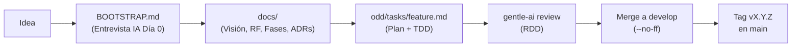

# Agent Blueprint 🏛️🤖

> **Plantilla y sistema de ingeniería guiada por documentación para desarrollar proyectos de software con agentes de IA (Claude Code, Antigravity, Cursor, OpenCode) y el ecosistema Gentle AI (ODD, RDD, Engram, CodeGraph).**
>
> Creado y mantenido por [AndyMartinezAparicio](https://github.com/AndyMartinezAparicio).

---

## 🧭 Filosofía Central

Agent Blueprint parte de una premisa fundamental: **la IA es un acelerador de ejecución extraordinario, pero el control arquitectónico, la coherencia del diseño y la responsabilidad final deben pertenecer al desarrollador humano**. Para evitar la degradación del código y las alucinaciones de contexto a medida que el proyecto crece, este sistema se asienta sobre cuatro pilares inquebrantables:

### 1. La documentación manda ("Un dato vive en un solo sitio")
- `docs/` es la **única fuente de verdad funcional y arquitectónica**. Todo lo relativo a visión, requisitos funcionales (RF), no funcionales (RNF), modelo de datos, fases y decisiones arquitectónicas (ADR) reside exclusivamente en `docs/`.
- `design/` manda únicamente en lo visual ("Notas del proyecto"): wireframes, tokens de color, componentes UI y directrices estéticas.
- Ningún agente puede implementar código que contradiga o preceda a la documentación aprobada.

### 2. Orquestador + Subagentes (Jerarquía y Especialización)
- **El agente orquestador (modelo principal)**: Razona, planifica, evalúa los 6 atributos de calidad clave (funcionalidad, mantenibilidad, rendimiento, seguridad, observabilidad, usabilidad), dialoga con el usuario ante cualquier ambigüedad y realiza revisiones críticas.
- **Los subagentes (modelos eficientes: Sonnet / Haiku / Flash)**: Ejecutan tareas mecánicas acotadas (búsquedas, generación de tests, escritura de funciones delimitadas, refactorizaciones específicas).
- **Regla de oro**: **Un solo escritor a la vez**. Los subagentes no conversan con el usuario humano ni toman decisiones de alto nivel.

### 3. Control total de permisos y Git (Autoría humana)
- **Lectura libre, mutación estricta**: El agente puede leer el árbol y explorar archivos con total libertad.
- **Aprobación previa**: Cualquier creación, modificación o eliminación de archivos, así como cualquier comando de Git que altere el estado (`commit`, `branch`, `merge`, `tag`, `push`), requiere proponer el cambio exacto y recibir aprobación explícita del usuario.
- **Autoría 100% humana**: En los commits no se incluyen menciones a asistentes ni etiquetas como `Co-Authored-By: Claude` o equivalentes de IA. El historial de Git refleja la responsabilidad del desarrollador.

### 4. Arquitectura Núcleo + Esqueleto (`skeleton/`) + Perfiles (`profiles/`)
- **Separación de responsabilidades**: Las reglas operativas universales para agentes se mantienen desacopladas de las particularidades de cada stack tecnológico.
- `skeleton/`: Plantilla limpia y agnóstica de plataforma lista para iniciar cualquier proyecto de software.
- `profiles/`: Directrices y buenas prácticas especializadas por ecosistema. Actualmente incluye el perfil probado en producción `profiles/mobile-flutter-store.md`, preparado para expandirse a perfiles Web, Backend y Escritorio.

---

## 🔄 Flujo de Trabajo

El ciclo de desarrollo garantiza que cada línea de código responda a un requisito validado, probado de forma guiada por pruebas (TDD) y auditado antes de incorporarse a la rama principal:



1. **Idea inicial**: Se concibe la necesidad de producto o funcionalidad.
2. **`BOOTSTRAP.md` (Entrevista Día 0)**: La IA formula preguntas estratégicas para desglosar objetivos, alcance, restricciones y arquitectura.
3. **`docs/`**: Se formalizan los documentos de visión, especificación funcional, backlog de fases y ADRs (Architectural Decision Records).
4. **`odd/tasks/<feature>.md`**: Implementación mediante *Opportunity-Driven Development* (ODD). Cada tarea incluye plan detallado, criterios de aceptación y tests unitarios previos al código productivo.
5. **`gentle-ai review`**: Evaluación rigurosa bajo *Review-Driven Development* (RDD) para verificar adherencia arquitectónica, cobertura y atributos de calidad.
6. **Merge a `develop`**: Integración continua en la rama activa mediante *pull request* o merge explícito con `--no-ff`.
7. **Release a `main`**: Despliegue de versiones estables etiquetadas formalmente mediante etiquetas semánticas `vX.Y.Z`.

---

## 🚀 Modos de Uso

Este repositorio ofrece dos modalidades operativas según tu objetivo:

### Modo 1 — Crear un proyecto nuevo desde cero
Utiliza esta plantilla para arrancar un desarrollo limpio con la estructura de ingeniería preconfigurada:
1. Copia el contenido de la carpeta `skeleton/` en el directorio de tu nuevo proyecto.
2. Selecciona el perfil tecnológico adecuado desde `profiles/` (por ejemplo, `profiles/mobile-flutter-store.md`) y añádelo a la documentación técnica de tu nuevo proyecto.
3. Abre tu entorno de IA favorito (Claude Code, Antigravity, Cursor, OpenCode) en la raíz del nuevo proyecto.
4. Indica al agente de IA la instrucción de inicio:
   ```text
   Lee BOOTSTRAP.md e inicializa este proyecto.
   ```
5. Responde a la entrevista guiada para generar la base documental y la configuración inicial de tu aplicación.

### Modo 2 — Mejorar o ampliar esta plantilla
Si deseas contribuir o personalizar el propio sistema Agent Blueprint:
1. Abre la raíz de `agent-blueprint` con tu agente de IA.
2. El agente detectará automáticamente el contexto dual definido en [AGENTS.md](file:///C:/Users/Andy/Desktop/Proyectos%20extras/agent-blueprint/AGENTS.md).
3. Consulta `docs/plan/roadmap.md` para trabajar en la creación de nuevos perfiles de plataforma (`profiles/web-react.md`, `profiles/desktop-tauri.md`), refinar habilidades de Gentle AI o perfeccionar las directrices de orquestación.

---

## 📂 Estructura del Repositorio

```text
agent-blueprint/
├── .atl/                          # Registro de habilidades (Gentle AI Skill Registry)
│   └── skill-registry.md          # Índice canónico de skills disponibles para subagentes
├── .gitignore                     # Exclusiones de Git y control de cachés locales
├── AGENTS.md                      # Reglas universales y directrices del orquestador de IA
├── CLAUDE.md                      # Adaptaciones operativas para Claude Code
├── README.md                      # Este documento
├── docs/                          # Documentación del sistema y hoja de ruta
│   ├── plan/                      # Roadmap y evolución de la plantilla
│   └── architecture/              # Principios de diseño del blueprint
├── profiles/                      # Perfiles técnicos por plataforma
│   └── mobile-flutter-store.md    # Perfil Mobile Flutter (Offline-First, Store-ready)
└── skeleton/                      # Esqueleto limpio para instanciar nuevos proyectos
    ├── .atl/
    │   └── skill-registry.md
    ├── BOOTSTRAP.md               # Entrevista inicial guiada por IA (Día 0)
    ├── AGENTS.md                  # Reglas del proyecto instanciado
    ├── CLAUDE.md                  # Configuración de Claude Code del proyecto
    ├── docs/                      # Estructura documental canónica (Visión, RF, ADRs, Fases)
    ├── design/                    # Notas de diseño visual y tokens UI
    └── odd/                       # Tareas ODD y seguimiento de ciclo de vida
```

---

## 📐 Atributos de Calidad Evaluados

Antes de autorizar cualquier propuesta arquitectónica o bloque de código significativo, el orquestador evalúa explícitamente:

| Atributo | Foco de Evaluación |
| :--- | :--- |
| **Funcionalidad** | Cumplimiento estricto del requisito funcional según `docs/`. |
| **Mantenibilidad** | Código autodocumentado, desacoplado, sin duplicidades ("DRY"). |
| **Rendimiento** | Uso eficiente de memoria, operaciones asíncronas no bloqueantes y latencia controlada. |
| **Seguridad** | Validación estricta de entradas, principio de mínimo privilegio y resguardo de datos sensibles. |
| **Observabilidad** | Trazabilidad clara de errores, logs estructurados y diagnósticos precisos. |
| **Usabilidad** | Ergonomía de API o interfaces claras y predecibles para el usuario final. |

---

## 🛠️ Ecosistema y Herramientas Soportadas

- **Agentes de IA**: Optimizado para **Claude Code**, **Google Antigravity**, **Cursor** y **OpenCode**.
- **Gentle AI Suite**:
  - **ODD (Opportunity-Driven Development)**: Gestión de tareas atómicas y tests ejecutables en `odd/tasks/`.
  - **RDD (Review-Driven Development)**: Evaluación continua con `gentle-ai review assess`.
  - **Engram**: Preservación de memoria técnica de sesión a sesión.
  - **CodeGraph**: Comprensión semántica de símbolos antes de manipular código fuente.

---

## 📄 Licencia y Créditos

Desarrollado con altos estándares de ingeniería por **Andy Martinez Aparicio**. Distribuido bajo licencia MIT. Las contribuciones orientadas a expandir perfiles y optimizar flujos de trabajo con agentes son bienvenidas siguiendo el **Modo 2**.
