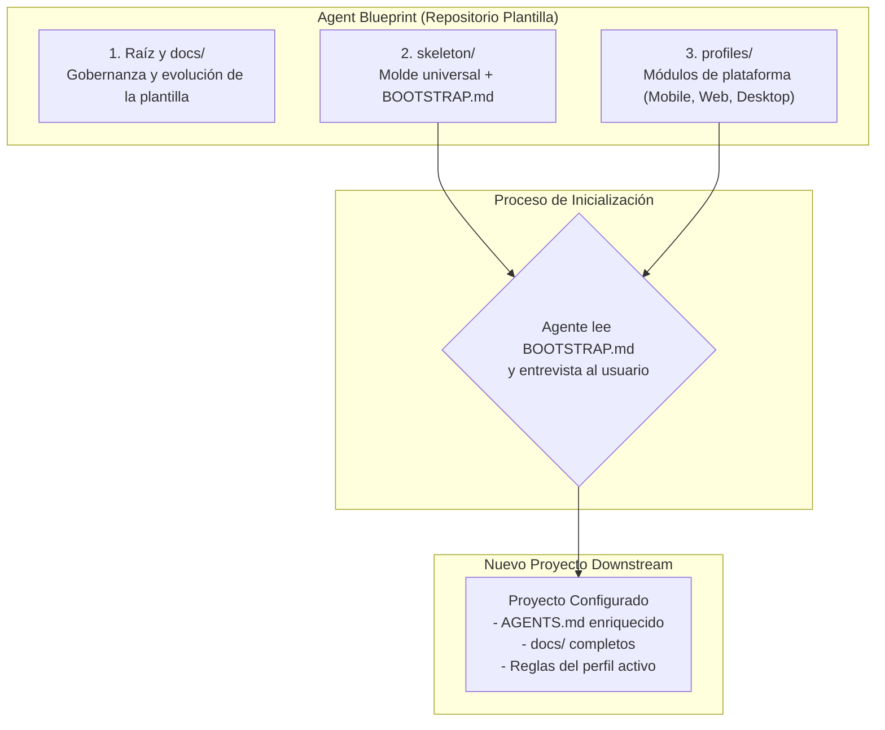
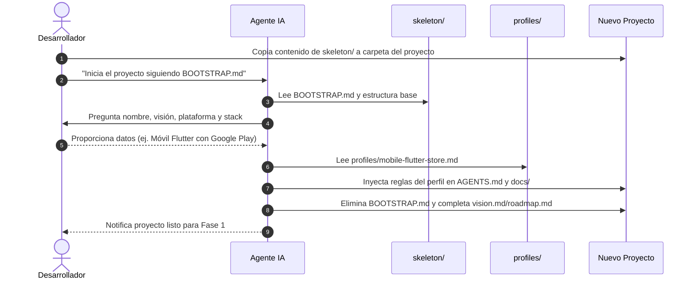

# Arquitectura de Agent Blueprint

Este documento describe la arquitectura modular del repositorio **Agent Blueprint**, diseñada para estandarizar la colaboración entre desarrolladores humanos y agentes de Inteligencia Artificial en cualquier proyecto de software.

---

## Modelo de 3 piezas

Para resolver la tensión entre la **universalidad** de las reglas de ingeniería (Git, RDD, control de cambios, comunicación) y la **especificidad** de cada entorno técnico (tiendas de aplicaciones, navegadores web, sistemas de escritorio), el repositorio se divide en tres componentes desacoplados:

### 1. La Raíz de gobernanza (`/`, `docs/`)
- **Propósito**: Aloja las directrices de evolución, el roadmap de versiones (`docs/plan/roadmap.md`), los registros de decisiones arquitectónicas (`docs/arquitectura/decisiones/`) y el historial de cambios de la propia plantilla (`docs/CHANGELOG.md`).
- **Comportamiento**: La plantilla se auto-gobierna con las mismas reglas de calidad que exige a los proyectos resultantes: ramas Gitflow ordenadas, sin commits directos a `main`, y trazabilidad total.
- **Aislamiento**: Nada en este nivel se copia directamente a un nuevo proyecto downstream, garantizando que el nuevo proyecto no herede debates o registros internos de la plantilla.

### 2. El Esqueleto universal (`skeleton/`)
- **Propósito**: Es el paquete limpio y autocontenido que se clona o copia al iniciar cualquier nuevo desarrollo.
- **Componentes clave**:
  - `BOOTSTRAP.md`: El protocolo interactivo que el agente de IA ejecuta en la primera sesión para entrevistar al humano, configurar la identidad del proyecto y fusionar las reglas de plataforma.
  - `AGENTS.md`: El manual universal de instrucciones para agentes de IA (filosofía Gentle AI, gobernanza Git, flujo ODD/RDD y ciclo de vida de tareas).
  - `docs/`: Árbol documental estructurado pero sin contenidos específicos de plataforma, con plantillas para visión (`vision.md`), hoja de ruta (`roadmap.md`), requerimientos (`requerimientos/sistema.md`) y guías de desarrollo (`desarrollo.md`).

### 3. Los Perfiles de plataforma (`profiles/`)
- **Propósito**: Módulos independientes que encapsulan el conocimiento especializado de una plataforma o stack técnico específico.
- **Funcionamiento**: Durante el proceso de inicialización guiado por `skeleton/BOOTSTRAP.md`, el agente identifica la plataforma destino del proyecto y toma el perfil correspondiente (por ejemplo, `profiles/mobile-flutter-store.md`). El agente inyecta sus directrices de calidad, validación pre-commit y políticas en los archivos del nuevo proyecto (`AGENTS.md`, `desarrollo.md`, `requerimientos/sistema.md`).
- **Extensibilidad**: Nuevas plataformas (Web, Desktop, Backend) se incorporan creando un nuevo archivo Markdown en `profiles/` siguiendo la plantilla `profiles/_TEMPLATE-profile.md`, sin modificar el esqueleto universal.

---

## Flujo del ciclo de vida

---

## Registro de Decisiones de Arquitectura (ADR)

Las decisiones clave que definen la estructura y comportamiento de `agent-blueprint` se documentan como ADRs formales:

| Número | Título | Estado | Fecha | Archivo |
| :---: | :--- | :---: | :---: | :--- |
| **0001** | Arquitectura de núcleo universal, esqueleto y perfiles modulares | **Aceptado** | 2026-10-18 | [`0001-arquitectura-nucleo-y-perfiles.md`](decisiones/0001-arquitectura-nucleo-y-perfiles.md) |
