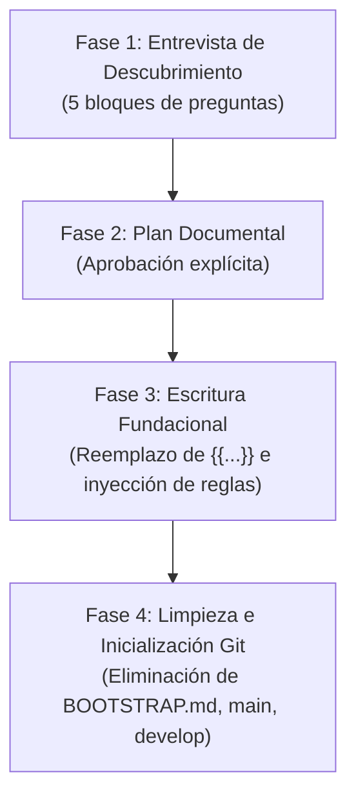

# Cómo crear un proyecto nuevo con Agent Blueprint (Paso a Paso)

Esta guía explica en detalle cómo iniciar un nuevo proyecto de software desde cero utilizando el sistema **Agent Blueprint**, combinando la estructura limpia de `skeleton/`, las reglas especializadas de `profiles/` y el protocolo interactivo de `skeleton/BOOTSTRAP.md`.

---

## Introducción: La tríada de inicialización

El proceso de creación de un nuevo proyecto se apoya en tres componentes coordinados:

1. **`skeleton/`**: El esqueleto universal del proyecto. Contiene la arquitectura documental base (`docs/`), los tokens de diseño (`design/`), la configuración de herramientas de IA (`AGENTS.md`, `CLAUDE.md`, `.claude/skills/`), el registro de skills (`.atl/`) y el protocolo de inicio (`BOOTSTRAP.md`).
2. **`profiles/`**: Catálogo de perfiles técnicos especializados (por ejemplo, `mobile-flutter-store.md`). Aportan reglas normativas, directrices de tiendas de aplicaciones, comandos de pre-commit y atributos de calidad propios de cada plataforma.
3. **`BOOTSTRAP.md`**: El protocolo interactivo que ejecuta tu agente de IA en el "Día 0" para entrevistar al desarrollador, proponer el plan documental, rellenar los marcadores de posición (`{{...}}`), inyectar las reglas del perfil y dejar el repositorio configurado con Git y Gentle AI.

---

## 1. Prerrequisitos

Antes de comenzar, asegúrate de contar con las siguientes herramientas en tu entorno local:

- **Git** instalado y accesible desde la línea de comandos (`git --version`).
- **Un agente de IA compatible**: Optimizado para [Claude Code](https://claude.ai/code), [Google Antigravity](https://github.com/google/antigravity), [Cursor](https://www.cursor.com) o [OpenCode](https://github.com/opencode-ai).
- **Gentle AI Suite** instalada globalmente (`gentle-ai --version`):
  - **Skill Registry**: Para indexar y refrescar skills disponibles (`gentle-ai skill-registry refresh`).
  - **RDD (Receipt-Driven Development)**: Para revisiones de calidad sin esperar a commits (`gentle-ai review assess`).
  - **Engram**: Para persistencia de memoria contextual entre sesiones de trabajo.

---

## 2. Elegir cómo arrancar (2 Modalidades)

Puedes iniciar tu nuevo proyecto mediante dos flujos de trabajo equivalentes. Elige el que mejor se adapte a tu forma de trabajar:

### Modalidad A — Asistida desde `agent-blueprint` (Recomendada)

En esta modalidad, aprovechas el **Contexto A** definido en `AGENTS.md`: abres tu agente de IA directamente en la raíz del repositorio `agent-blueprint` y le pides que cree el nuevo proyecto en otra carpeta de tu equipo.

**Ventajas:**
- El agente tiene acceso simultáneo y directo a `skeleton/` y al catálogo completo de `profiles/`.
- No necesitas copiar manualmente ningún archivo ni carpeta oculta.
- El agente se encarga de crear el directorio destino, copiar los archivos base y ejecutar la entrevista guiada en un solo flujo continuo.

**Prompt listo para usar (copiar y pegar en el agente):**

```text
Inicializa un nuevo proyecto en "<RUTA_ABSOLUTA_DESTINO>" usando el perfil "profiles/mobile-flutter-store.md" (o sin perfil específico) y ejecuta el protocolo de skeleton/BOOTSTRAP.md.
```

> **Ejemplo en Windows:**
> ```text
> Inicializa un nuevo proyecto en "C:\Users\Andy\Desktop\MiNuevaApp" usando el perfil "profiles/mobile-flutter-store.md" y ejecuta el protocolo de skeleton/BOOTSTRAP.md.
> ```
>
> **Ejemplo en Linux / macOS:**
> ```text
> Inicializa un nuevo proyecto en "/home/usuario/proyectos/mi-nueva-app" usando el perfil "profiles/mobile-flutter-store.md" y ejecuta el protocolo de skeleton/BOOTSTRAP.md.
> ```

---

### Modalidad B — Copia manual desde la terminal

Si prefieres preparar manualmente la carpeta de destino antes de invocar al agente, sigue estos pasos:

#### Paso B.1: Crear la carpeta destino y copiar `skeleton/`
Copia todo el contenido de `skeleton/` en tu nueva carpeta, asegurándote de incluir carpetas y archivos ocultos (`.claude/`, `.atl/`, `.gitignore`).

- **PowerShell (Windows):**
  ```powershell
  New-Item -ItemType Directory -Path "C:\Ruta\De\MiProyecto" -Force
  Copy-Item -Path "C:\Ruta\A\agent-blueprint\skeleton\*" -Destination "C:\Ruta\De\MiProyecto" -Recurse -Force
  ```

- **Bash (Linux / macOS):**
  ```bash
  mkdir -p /ruta/de/mi-proyecto
  cp -a /ruta/a/agent-blueprint/skeleton/. /ruta/de/mi-proyecto/
  ```

#### Paso B.2: Indicar o enlazar el perfil técnico
Dado que la carpeta `profiles/` reside en la raíz de `agent-blueprint` (fuera de `skeleton/`), tienes dos opciones para que el agente consulte el perfil:
1. **Pasar la ruta absoluta del perfil en el prompt** (la opción más limpia y recomendada).
2. **Copiar temporalmente el archivo del perfil** (por ejemplo, `profiles/mobile-flutter-store.md`) dentro de la raíz de tu nuevo proyecto para que el agente lo lea, y borrarlo al finalizar el bootstrap.

#### Paso B.3: Abrir el agente en el nuevo proyecto y arrancar
Abre tu terminal o editor con soporte de agente en la raíz de la nueva carpeta (`C:\Ruta\De\MiProyecto` o `/ruta/de/mi-proyecto`) y envía el prompt de arranque:

```text
Lee BOOTSTRAP.md e inicializa este proyecto. (Opcional: Usa el perfil en <RUTA_A_AGENT_BLUEPRINT>/profiles/mobile-flutter-store.md)
```

---

## 3. El Protocolo Día 0: Qué esperar en cada fase (`BOOTSTRAP.md`)

Una vez iniciado el protocolo, el agente de IA guiará la inicialización a través de cuatro fases estandarizadas:



### Fase 1 — Entrevista de Descubrimiento (Cheat-sheet para el humano)

El agente te formulará **5 bloques de preguntas clave**. Para agilizar la sesión, ten pensadas las respuestas a estos puntos:

| Bloque | Tema clave | Qué debes tener definido |
| :--- | :--- | :--- |
| **1. Identidad y estructura** | Nombre y código | • Nombre oficial del proyecto (`{{NOMBRE_PROYECTO}}`).<br/>• Carpeta donde vivirá el código fuente (`app/`, `src/`, `cliente/`, etc.). |
| **2. Visión y Producto** | Propósito y usuarios | • Problema central que resuelve la aplicación.<br/>• Propuesta de valor única.<br/>• Perfil del usuario destinatario (B2C, B2B, edad, nivel técnico). |
| **3. Perfil Técnico y Entorno** | Stack y restricciones | • Plataforma destino (móvil, web, desktop, backend).<br/>• Perfil de `profiles/` aplicable (ej. `mobile-flutter-store.md`).<br/>• Restricciones del entorno local (SO, emulador vs dispositivo físico por USB, versiones de SDK). |
| **4. Alcance Inicial (v1.0) y Datos** | MVP y privacidad | • Requisitos funcionales clave de la versión 1.0 (`RF-01` a `RF-XX`).<br/>• Qué funcionalidades quedan explícitamente fuera de la v1.0.<br/>• Requisitos no negociables: modo offline, privacidad estricta, sin telemetría, RGPD o directrices de Google Play / App Store. |
| **5. Diseño Visual y Experiencia** | UI y estética | • Referencias visuales (wireframes en `design/`, Figma, capturas).<br/>• Estética general (Material 3, minimalista, colores de marca).<br/>• Soporte de tema claro / oscuro y layouts prioritarios. |

---

### Fase 2 — Propuesta de Plan Documental (Aprobación humana)

Una vez contestadas las preguntas, **el agente no escribirá archivos de inmediato**. Presentará un resumen estructurado detallando cómo quedará configurada la documentación fundacional:

1. `AGENTS.md`: Identidad, reglas de arquitectura y comandos pre-commit.
2. `docs/producto/vision.md` y `docs/producto/requisitos.md`: Visión del producto, matriz de requisitos (`RF-01..RF-N`) y no funcionales (`RNF-01..RNF-N`).
3. `docs/arquitectura/overview.md` y `docs/arquitectura/decisiones/0001-stack-y-arquitectura-inicial.md`: Arquitectura del sistema, capas y primer ADR fundacional.
4. `docs/plan/roadmap.md` y `docs/plan/fases/fase-01-fundacion.md`: Roadmap general y desglose minucioso de tareas para arrancar la Fase 1.
5. `docs/guias/desarrollo.md`: Guía de comandos locales (compilación, pruebas, formateo y linter).
6. `design/DESIGN.md`: Tokens de diseño, paleta cromática y componentes base.
7. `.claude/skills/project-ui/` y `.claude/skills/material-design/`: Skills adaptadas a la identidad y plataforma elegida.

> [!IMPORTANT]
> El agente se detendrá obligatoriamente y esperará tu confirmación explícita antes de escribir o modificar cualquier archivo.

---

### Fase 3 — Escritura Fundacional

Tras recibir tu aprobación:
- El agente sustituye todos los marcadores de posición (`{{...}}`) en `AGENTS.md`, `README.md`, `design/` y `docs/`.
- Inyecta fielmente las reglas técnicas, normativas y de privacidad del perfil seleccionado (por ejemplo, directrices de permisos para Android, políticas de Google Play o almacenamiento offline).
- Garantiza que **no quede ningún placeholder sin resolver** en todo el proyecto.
- Presenta un informe detallado con los archivos creados y actualizados.

---

### Fase 4 — Limpieza (`BOOTSTRAP.md`) e Inicialización de Git

Para culminar el Día 0:
1. **Permiso para eliminar `BOOTSTRAP.md`**: El agente te solicitará autorización explícita para borrar `BOOTSTRAP.md`, ya que su propósito ha concluido.
2. **Propuesta y ejecución de comandos fundacionales**: Con tu autorización, el agente ejecutará los comandos necesarios para arrancar el control de versiones y el registro de skills:

```powershell
# 1. Inicializar repositorio Git y rama principal
git init -b main

# 2. Registrar documentación fundacional en el primer commit
git add .
git commit -m "docs: inicializar arquitectura y documentacion fundacional"

# 3. Crear y cambiar a la rama de integración continua develop
git checkout -b develop

# 4. Refrescar el registro de skills de Gentle AI
gentle-ai skill-registry refresh
```

---

## 4. Lista de verificación al terminar el Día 0

Antes de dar por concluida la inicialización, comprueba los siguientes puntos:

- [ ] **Limpieza**: El archivo `BOOTSTRAP.md` ya no existe en el repositorio del nuevo proyecto.
- [ ] **Sin marcadores**: No queda ningún marcador `{{...}}` sin resolver en `AGENTS.md`, `README.md`, `docs/`, `design/` ni `.claude/skills/`.
- [ ] **Ramas Git configuradas**:
  - Rama `main` creada con el commit inicial fundacional (`docs: inicializar arquitectura y documentacion fundacional`).
  - Rama activa `develop` creada a partir de `main` y lista para recibir ramas de trabajo.
- [ ] **Registro de skills**: El archivo `.atl/skill-registry.md` está generado y actualizado mediante `gentle-ai skill-registry refresh`.
- [ ] **Fuente de verdad establecida**: `docs/` contiene la visión, requisitos, arquitectura fundacional (ADR 0001) y roadmap con la Fase 1 desglosada.

---

## 5. Día 1 en adelante: Cómo empezar a programar (Fase 1)

Con la documentación fundacional aprobada y Git configurado, el desarrollo de código sigue el flujo profesional de Agent Blueprint:

1. **Consultar la Fase 1**:
   Revisa `docs/plan/roadmap.md` y `docs/plan/fases/fase-01-fundacion.md` para identificar la primera tarea técnica aprobada.
2. **Crear una rama de trabajo temporal**:
   Desde la rama `develop`, crea la rama correspondiente (solicitando confirmación previa al usuario según `AGENTS.md`):
   ```bash
   git checkout -b feature/fase-01-configuracion-inicial
   ```
3. **Flujo ODD (Organic Driven Development)**:
   - Antes de escribir código, define o actualiza el archivo de tareas en `odd/tasks/<feature>.md` (desglosando pasos, criterios de aceptación y tests unitarios).
   - Recuerda: **Plan antes que código**.
4. **Desarrollo y Revisión RDD**:
   - Implementa guiado por pruebas (TDD).
   - Al finalizar un bloque de trabajo, evalúa los cambios en el árbol de trabajo con:
     ```bash
     gentle-ai review assess
     ```
   - Recuerda: en este flujo, comitear cambios ya revisados no vuelve a disparar otra revisión.
5. **Integración continua**:
   - Una vez validados los tests y la revisión RDD, fusiona la rama de trabajo hacia `develop` utilizando `--no-ff` para preservar la trazabilidad histórica:
     ```bash
     git checkout develop
     git merge --no-ff feature/fase-01-configuracion-inicial
     ```
